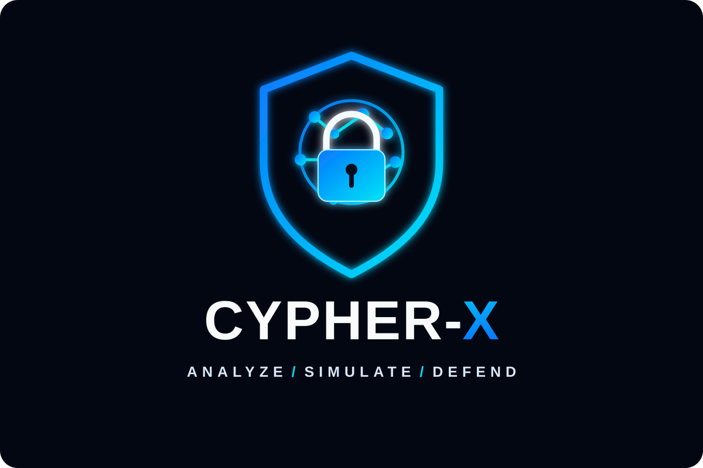

# CYPHER-X

  

> **AI-assisted cybersecurity for attack propagation analysis, infrastructure impact assessment, and defensive decision-making.**

CYPHER-X is a planned cybersecurity platform designed to help users understand how a potential cyberattack could affect interconnected infrastructure and evaluate defensive strategies before applying them. It aims to model infrastructure dependencies, identify potential attack paths, estimate the blast radius of security incidents, and compare simulated containment strategies.

Unlike a conventional security monitoring dashboard, CYPHER-X focuses on three questions:
- How far could an attack spread?
- Which defensive action could reduce its impact?
- What risks would remain after containment?

**Project status:** Initial setup / under development. Features described below are planned capabilities and should not be considered implemented until built and tested.

## The Problem

Modern organizations depend on interconnected applications, servers, databases, user accounts, and third-party services. When one component is compromised, its connections and permissions may create pathways through which an attacker could reach other systems or critical assets.

Security alerts alone do not necessarily show the full potential impact of an incident. Security teams may need to investigate infrastructure relationships, trace possible attack paths, identify affected services, and decide which components to isolate. Poorly chosen containment actions can also disrupt legitimate business operations.

The Change Healthcare ransomware incident in February 2024 illustrates how an attack on a critical service provider can have wider operational consequences. CYPHER-X uses this type of incident as motivation for studying modeled attack propagation and infrastructure impact; the prototype will not reconstruct the company's private infrastructure.

## Our Solution

CYPHER-X aims to provide an interactive cybersecurity environment where users can model infrastructure, select a simulated security incident, explore potential attack paths, and evaluate containment options.

The platform is intended to estimate which connected components could be exposed, highlight critical assets, and compare defensive actions such as isolating a server or disabling a compromised account.

Simulated results should distinguish the initial incident, potential exposure, supporting evidence, assumptions, and residual risk. The objective is to support informed defensive decisions before changes are applied to real systems.

## Key Features

1. **AI-Assisted Threat Analysis** — Analyze suspicious events and prioritize potential threats. AI-generated explanations are planned as an enhancement after the core analysis engine works.
2. **Infrastructure Dependency Mapping** — Visualize servers, applications, databases, accounts, and their configured relationships in an interactive graph.
3. **Attack Propagation Simulation** — Model potential attack paths from an initially compromised component to other reachable components, according to defined dependency and access rules.
4. **Infrastructure Blast-Radius Analysis** — Estimate which services and critical assets could be affected by a simulated incident.
5. **What-If Defence Simulator** — Test hypothetical incidents and defensive actions in a controlled model without modifying real infrastructure.
6. **Adaptive Containment Planner** — Compare options such as isolating a server, disabling an account, or restricting a simulated connection.
7. **Defence Outcome Comparison** — Compare potential exposure, remaining attack paths, and estimated service disruption before and after simulated containment.
8. **Explainable Risk Analysis** — Show the paths, modeled relationships, evidence, and assumptions behind each result.
9. **Incident Investigation and Timeline** — Organize related security events into a timeline to support incident analysis.
10. **Security Alerts and Recommendations** — Present suspicious events, risk priorities, and suggested investigation or containment steps.
11. **Impact Reports and Audit History** — Summarize incident details, simulation results, recommended actions, and recorded defensive decisions.
12. **Privacy and Access Control** — Plan authentication, authorization, and audit logging to protect sensitive information and restrict security operations.

## How It Is Intended to Work

1. **Model infrastructure:** Create a graph of simulated infrastructure components and their dependencies.
2. **Select an incident:** Choose a simulated scenario, such as a compromised API server or administrator account.
3. **Analyze potential attack paths:** Traverse modeled dependencies and access relationships to identify components that could be exposed.
4. **Calculate the potential blast radius:** Highlight reachable components, critical assets, and service dependencies that may be affected.
5. **Simulate defensive actions:** Test containment options, such as isolating the affected server or disabling the simulated account.
6. **Compare outcomes:** Recalculate modeled attack paths and compare potential exposure and service disruption across scenarios.
7. **Generate a response report:** Explain the results, recommended actions, remaining risks, and assumptions.

All simulated changes should remain within the modeled environment unless a separately authorized real-system integration is implemented and tested.

## Proposed Technology Stack

| Component | Technology | Intended Purpose |
|---|---|---|
| Frontend | React.js, TypeScript | Interactive web interface |
| Build Tool | Vite | Frontend development and builds |
| Graph Visualization | React Flow (`@xyflow/react`) | Infrastructure maps and attack-path visualization |
| Styling | CSS or Tailwind CSS | Responsive user interface |
| Core Analysis Engine | TypeScript | Graph traversal, reachability, and blast-radius calculations |
| Initial Data Model | Local TypeScript data | Simulated infrastructure, dependencies, and incidents |
| Backend | Java, Spring Boot (optional later) | APIs and centralized application workflows |
| Database | PostgreSQL (planned) | Persistent infrastructure, incident, and audit records |
| API Communication | REST APIs (planned) | Connect frontend to a future backend |
| Real-Time Updates | WebSockets (optional) | Deliver incident and status updates |
| AI Enhancement | LLM API or local model (optional) | Explain findings and summarize investigation evidence |
| Testing | Vitest or another TypeScript test framework | Validate attack-path and containment logic |
| Version Control | Git, GitHub | Source-code management |
| Packaging | Docker (optional) | Consistent development and deployment |

The initial technology choices prioritize a working prototype. The first version should implement the graph model, attack-path engine, containment simulation, and before-and-after comparison before adding a backend, database, machine learning, or an external AI service.

## Expected Impact

CYPHER-X aims to:
- Improve visibility into potential attack propagation across interconnected infrastructure.
- Help users identify critical components that may require investigation.
- Make infrastructure blast-radius assessment easier to understand.
- Compare containment strategies before applying defensive changes.
- Explain why certain components are considered potentially exposed.
- Support informed decisions by showing residual risk and possible service disruption.
- Provide a repeatable environment for cybersecurity demonstrations and defensive planning.

These are intended benefits. Accuracy, usefulness, and effectiveness will need to be evaluated through testing.

## Responsible Use

CYPHER-X is intended for defensive cybersecurity, authorized environments, and controlled simulation.

- Use simulated infrastructure and test scenarios for the initial prototype.
- Distinguish observed events from inferred attack paths and potential exposure.
- Do not treat a graph connection alone as proof that an attacker can compromise a component.
- Make assumptions and limitations visible in reports.
- Require human review before any future integration performs high-impact actions on real systems.
- Do not claim that simulated containment prevents a real attack without supporting evidence.

## Development Roadmap

- [ ] Create and maintain CYPHER-X as a standalone repository, separate from ZentraSec AI.
- [ ] Set up the React, TypeScript, and Vite frontend.
- [ ] Define infrastructure node, dependency edge, and incident data models.
- [ ] Build an interactive infrastructure dependency map.
- [ ] Implement deterministic attack-path and blast-radius calculations.
- [ ] Add simulated incident scenarios and component selection.
- [ ] Implement simulated isolation and alternative containment options.
- [ ] Build before-and-after risk and service-impact comparisons.
- [ ] Display explanations for identified paths and potentially exposed assets.
- [ ] Test cycles, disconnected components, multiple paths, and remaining paths after containment.
- [ ] Add impact reports and simulation audit history.
- [ ] Evaluate whether AI-generated explanations add measurable value.
- [ ] Consider Spring Boot, PostgreSQL, authentication, and real-time updates after the core prototype works.
- [ ] Evaluate the prototype against documented incident scenarios without claiming to reproduce a real company's private infrastructure.

## Project Goal

**Understand how a cyberattack could propagate, evaluate defensive options, and make better-informed containment decisions before acting.**

---

*This README describes the CYPHER-X project vision and proposed design. Update the feature list and roadmap as capabilities are implemented, tested, and validated. The Change Healthcare incident provides real-world motivation; infrastructure and attack paths in the prototype are illustrative simulations, not a reconstruction of its actual systems.*
